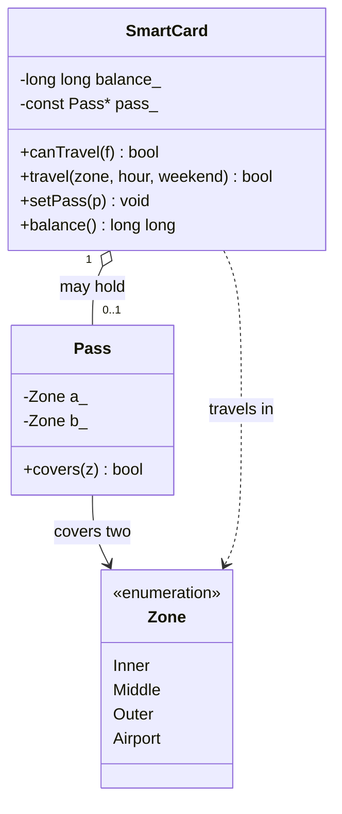

# Task 12 - Re-evaluate and Adapt the Design (Day-4 Design Challenge)

**Name:** <your name>
**Register No:** <your register number>
**Course:** Object-Oriented Programming using C++ - Assignment 1 [CO1]

> Files in this folder:
> - `task12_analysis.md` - this analysis (parts A to D)
> - `task12_original_switch.cpp` and `task12_original_output.txt` - the **original** switch-based design with Airport added to the enum only (shows the failure)
> - `task12.cpp` and `task12_output.txt` - the **modified** design: fare table indexed by zone, separate weekend rule, `Pass` class (18 of 18 tests pass)
> - output screenshots of both programs

**Compile and run:**
```
g++ -std=c++17 -Wall -Wextra task12_original_switch.cpp -o orig
./orig
g++ -std=c++17 -Wall -Wextra task12.cpp -o task12
./task12
```

## Changed requirement

The metro adds:
1. a fourth zone, **Airport, Rs 60**;
2. a **10% weekend discount** that does **not** combine with the peak surcharge;
3. a **monthly pass** that allows unlimited journeys in **two chosen zones**.

**Decision: MODIFY** the original design (not retain, not redesign).

---

## A. Impact Analysis (2 marks)

| Element of the original design | Affected? | What must change |
|---|---|---|
| `enum class Zone { Inner, Middle, Outer }` | **Yes** | add `Airport` |
| `BASE_PAISE[] = {1000, 2000, 3000}` | **Yes** | add 6000 as a fourth element |
| Every `switch` on the zone (the fare function) | **Yes** | add `case Zone::Airport` to every switch, or remove the switch |
| `PEAK_SURCHARGE_PERCENT` | No change | stays 20 |
| New constant | **Yes** | `WEEKEND_DISCOUNT_PERCENT = 10` |
| Fare expression `fare(zone, peak)` | **Yes** | new input (weekend flag) and a rule order: weekend discount **replaces** the peak surcharge |
| `isPeak(hour)` | No change | the peak intervals are unchanged |
| `SmartCard` (private balance, Rs 50 rule) | **Small** | the balance rule is unchanged; it needs an optional link to a pass |
| `Pass` | **New class** | stores the two covered zones, `covers(zone)` |
| Task 9 test table | **Yes** | new rows for Airport, weekend and pass cases |



---

## B. Evaluation of the Original Design (2 marks)

### Worked examples with the new rules

| Case | Rule applied | Calculation | Correct fare |
|---|---|---|---|
| Airport, weekday, 12:00 | base only | 6000 | 6000 paise (Rs 60.00) |
| Airport, weekday, 09:00 (peak) | base + 20% | 6000 + 1200 | 7200 paise (Rs 72.00) |
| Airport, **weekend**, 09:00 | 10% discount, **no** surcharge | 6000 - 600 | **5400** paise (not 7200) |
| Inner, weekend, 12:00 | 10% discount | 1000 - 100 | 900 paise |
| Outer, weekend, 18:00 (peak hour) | 10% discount, **no** surcharge | 3000 - 300 | 2700 paise (not 3600) |

### Can the original switch-based fare logic absorb the change? Test result

I added `Airport` to the enum but left the original `switch` unchanged (`task12_original_switch.cpp`):

```cpp
switch (z) {
    case Zone::Inner:  base = BASE_PAISE[0]; break;
    case Zone::Middle: base = BASE_PAISE[1]; break;
    case Zone::Outer:  base = BASE_PAISE[2]; break;
}                                        // no Airport case, no default
```

**Actual output:**

```
Original design, Airport weekday 12:00 fare = 0 paise (should be 6000)
```

**Compiler warning received:**

```
task12_original_switch.cpp:11:12: warning: enumeration value 'Airport' not handled in switch [-Wswitch]
```

**Evaluation of the original switch:** it can absorb the new zone **only if every `switch` on the zone is found and edited**. If one is missed, the program compiles (with only a warning) and **silently charges Rs 0 for a Rs 60 journey**, because `base` keeps its initial value of 0. The weekend rule is only an extra branch, but it must be tested **before** the peak branch, otherwise both rules would combine (an Airport weekend peak journey would wrongly become 6000 + 20% - 10%). Also, the old function `fare(Zone, bool peak)` has no input for the day, so its signature must change, and so must every caller.

**Can the `SmartCard` class absorb the change?** Yes. The rule "the balance must be at least Rs 50 after a journey" does not change, and `balance_` is still private and changed only by one function. The original class needed **no change to its balance logic**. A pass is a separate idea, so I added a small separate `Pass` class instead of putting zone logic inside `SmartCard`; this keeps each class to one responsibility.

**Conclusion of the evaluation:** the structure (constants in one place, `long long` paise, private balance) is sound and keeps its value; only the switch is fragile. That points to **MODIFY**, replacing the switch with a table, not a full redesign.

---

## C. Adaptation (2 marks)

### Revised design

```cpp
enum class Zone { Inner, Middle, Outer, Airport };

constexpr std::array<long long, 4> FARE_PAISE{1000, 2000, 3000, 6000};   // indexed by Zone
static_assert(FARE_PAISE.size() == 4, "fare table must have one entry per Zone");
constexpr int       PEAK_PERCENT = 20;
constexpr int       WEEKEND_DISCOUNT_PERCENT = 10;
constexpr long long MIN_BALANCE_PAISE = 5000;

bool isPeak(int h) { return (h >= 8 && h < 10) || (h >= 17 && h < 20); }

// the weekend discount replaces the peak surcharge; the two never combine
long long fare(Zone z, int hour, bool weekend) {
    long long f = FARE_PAISE[static_cast<std::size_t>(z)];
    if (weekend)           f -= f * WEEKEND_DISCOUNT_PERCENT / 100;
    else if (isPeak(hour)) f += f * PEAK_PERCENT / 100;
    return f;
}

class Pass {                                       // monthly pass: unlimited travel in two zones
    Zone a_, b_;
public:
    Pass(Zone a, Zone b) : a_{a}, b_{b} {}
    bool covers(Zone z) const { return z == a_ || z == b_; }
};

class SmartCard {
    long long balance_;
    const Pass* pass_ = nullptr;
public:
    explicit SmartCard(long long b) : balance_{b} {}
    void setPass(const Pass* p) { pass_ = p; }
    bool canTravel(long long f) const { return f >= 0 && balance_ - f >= MIN_BALANCE_PAISE; }
    bool travel(Zone z, int hour, bool weekend) {
        if (pass_ && pass_->covers(z)) return true;       // covered by the pass: no deduction
        long long f = fare(z, hour, weekend);
        if (!canTravel(f)) return false;
        balance_ -= f;
        return true;
    }
    long long balance() const { return balance_; }
};
```

### What changed and why

| Change | Reason |
|---|---|
| fare **table indexed by zone** instead of a `switch` | a new zone is one array element plus one enum value; there is no switch to forget, and `static_assert` stops the table and the enum from going out of step in size |
| **separate discount rule** (`if (weekend) ... else if (peak) ...`) | the two rules cannot combine because of the `else`; the order is visible in one line |
| **`Pass` class** | the pass is a new concept with its own data (two zones); `SmartCard` only asks `covers(zone)` |
| `SmartCard::canTravel` and the private balance | **unchanged logic**: the Rs 50 rule still protects every journey |

---

## D. Evidence-Based Defence (2 marks)

### Test results

**Actual output of `task12.cpp`:**

```
--- Fares ---
PASS  Airport weekday 12:00 off-peak         expected 6000  actual 6000
PASS  Airport weekday 09:00 peak             expected 7200  actual 7200
PASS  Airport weekend 09:00 (no surcharge)   expected 5400  actual 5400
PASS  Airport weekend 12:00                  expected 5400  actual 5400
PASS  Inner   weekend 12:00                  expected 900  actual 900
PASS  Outer   weekend 18:00 (no surcharge)   expected 2700  actual 2700
PASS  Outer   weekday 18:00 peak             expected 3600  actual 3600
PASS  Middle  weekday 10:00 off-peak         expected 2000  actual 2000

--- Pass ---
PASS  journey inside pass zone (Inner)       expected 1  actual 1
PASS    balance unchanged                    expected 20000  actual 20000
PASS  journey inside pass zone (Middle)      expected 1  actual 1
PASS    balance unchanged                    expected 20000  actual 20000
PASS  journey outside pass zone (Outer)      expected 1  actual 1
PASS    fare 3000 deducted                   expected 17000  actual 17000

--- Balance rule still holds ---
PASS  exactly Rs 50 left after Outer         expected 1  actual 1
PASS    balance                              expected 5000  actual 5000
PASS  Airport with balance 7000 refused      expected 0  actual 0
PASS    balance unchanged                    expected 7000  actual 7000

18/18 tests passed
```

| Group | Result |
|---|---|
| New Airport fares (weekday off-peak, weekday peak) | pass |
| Weekend discount with no surcharge (Airport 5400, Outer peak hour 2700) | pass |
| Monthly pass: no deduction inside the two zones, normal fare outside | pass |
| Rs 50 minimum balance still enforced with the new Rs 60 zone (balance 7000 refused) | pass |
| Original rules still correct (Outer weekday peak 3600, Middle off-peak 2000) | pass |

### Defence of the decision: MODIFY

1. **The rules that matter did not change.** Exact paise arithmetic, `constexpr` constants in one place and the private balance with the Rs 50 rule all still hold, as the 18 passing tests show.
2. **The change was small and local:** one array element, one enum value, one constant, one branch and one small class. The `SmartCard` balance logic was not touched.
3. **A full redesign would add risk without benefit.** Everything that already passed in Tasks 7 and 9 would have to be rewritten and retested.
4. **Keeping unchanged would have failed.** The original switch gave **Rs 0** for the Airport zone (shown above), so "retain" is not acceptable.

### Trade-offs

| Trade-off | Detail |
|---|---|
| Table versus `switch` | the table needs no per-switch edit and is O(1); but its order must match the enum order, so a `static_assert` guards the size. A `switch` gives the compiler's `-Wswitch` warning for missing cases, which the table does not. |
| Weekend rule order | an `else if` keeps the discount and the surcharge from combining, but the order in the code **is** the rule, so it must be covered by tests (done). |
| `Pass` outside `SmartCard` | keeps one responsibility per class, at the cost of one extra pointer per card (8 bytes). |
| Pass validity dates | not modelled (a real monthly pass expires); this is a limitation and a possible future extension. |
| Time and space | a journey is still **O(1)**; the fare table grows by 8 bytes per zone. |

### Final decision

**Modify.** The tested evidence shows the original design failed on exactly one point (the switch) and held on all others, so the fare logic is changed to a table with a separate discount rule, a `Pass` class is added, and the `SmartCard` rules are kept.

---

## Evidence summary

- Impact table and class diagram (part A)
- Worked examples, the original switch failure (Rs 0 and a `-Wswitch` warning) and an evaluation of each class (part B)
- Revised code with a justification of each change (part C)
- 18 of 18 passing tests, the defence of **Modify** and the trade-offs (part D)
