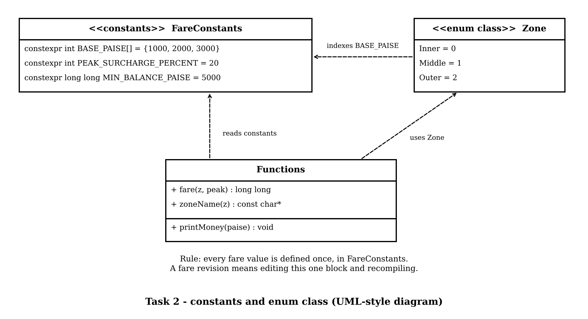

# Task 2 - Use Tokens, Keywords, Identifiers and Constants Correctly

**Name:** <your name>
**Register No:** <your register number>
**Course:** Object-Oriented Programming using C++ - Assignment 1 [CO1]

> Files in this folder:
> - `task02_analysis.md` - this analysis
> - `task02.cpp` - program with all constants defined in one place
> - `task02_output.txt` and the output screenshot - result of running `task02.cpp`
> - `uml_diagram_task2.png` - UML-style diagram of the constants and the enum class

**Compile and run:**
```
g++ -std=c++17 -Wall -Wextra task02.cpp -o task02
./task02
```

---

## 1. The five kinds of tokens

Take this line from the program:

```cpp
constexpr int PEAK_SURCHARGE_PERCENT = 20;
```

| Token kind | Example from this line | Other examples in the program |
|---|---|---|
| Keyword | `constexpr`, `int` | `enum`, `class`, `switch`, `case`, `return`, `if`, `for`, `const` |
| Identifier | `PEAK_SURCHARGE_PERCENT` | `fare`, `zoneName`, `printMoney`, `Zone`, `BASE_PAISE` |
| Constant (literal) | `20` | `1000`, `5000`, `'.'`, `'0'`, `true`, `false` |
| Operator | `=` | `+`, `*`, `/`, `%`, `<<`, `+=`, `<` |
| Punctuator | `;` | `{ }`, `( )`, `[ ]`, `,`, `::` |

---

## 2. `#define`, `const` and `constexpr`

| Feature | `#define PEAK 20` | `const int PEAK = 20;` | `constexpr int PEAK = 20;` |
|---|---|---|---|
| Handled by | preprocessor (text replacement) | compiler | compiler |
| Has a type | No | Yes | Yes |
| Has a scope | No (applies to the rest of the file) | Yes | Yes |
| Value known at compile time | Yes (it is just text) | Not guaranteed | **Guaranteed** |
| Usable as array size / `switch` label | Yes | Only sometimes | **Always** |
| Shown by the debugger | No | Yes | Yes |

**Why `constexpr` is preferred for the fare table:** it is type-checked, it has a scope, and the compiler guarantees the value is fixed at compile time. A fare therefore cannot be changed by accident while the program runs, and it can be used wherever a compile-time constant is needed.

---

## 3. `enum` and `enum class` for zones

```cpp
enum class Zone { Inner, Middle, Outer };
```

| Point | plain `enum` | `enum class` |
|---|---|---|
| Names | leak into the surrounding scope (`Inner` becomes a global name) | scoped: must write `Zone::Inner` |
| Conversion to `int` | automatic and silent | not allowed without `static_cast` |
| Two enums with the same name | clash | no clash |

**Why `enum class` is safer:** a zone cannot be mixed up with an ordinary number. I tested this: the line `int bad = Zone::Inner;` is rejected by the compiler with

```
error: cannot convert 'Zone' to 'int' in initialization
```

With a plain `enum` the same line would be accepted silently.

---

## 4. Naming rules and conventions for identifiers

**Rules (enforced by the compiler):**
- Only letters, digits and underscore.
- Cannot start with a digit.
- Cannot be a keyword.
- Case-sensitive (`fare` and `Fare` are different).

**Conventions used in this program:**

| Kind | Convention | Example |
|---|---|---|
| Constants | UPPER_SNAKE_CASE | `MIN_BALANCE_PAISE` |
| Classes and enums | PascalCase | `Zone`, `SmartCard` |
| Functions and variables | camelCase | `zoneName`, `printMoney` |
| Private data members | trailing underscore | `balance_` |

Meaningful names (`PEAK_SURCHARGE_PERCENT`, not `P`) also include the unit (`_PAISE`, `_PERCENT`), so the meaning of a value is clear without a comment.

---

## 5. Evidence: one set of well-named constants

```cpp
enum class Zone { Inner, Middle, Outer };

constexpr int       BASE_PAISE[] = {1000, 2000, 3000};   // Rs 10, Rs 20, Rs 30
constexpr int       PEAK_SURCHARGE_PERCENT = 20;         // 20% in peak hours
constexpr long long MIN_BALANCE_PAISE = 5000;            // Rs 50 must remain on the card
```

A fare revision (for example Inner from Rs 10 to Rs 12) is made by changing one number in this block and recompiling. No other line of the program changes.



**Program output (compiled with `g++ -std=c++17 -Wall -Wextra`, no warnings):**

```
Zone     Off-peak    Peak
Inner    Rs 10.00    Rs 12.00
Middle   Rs 20.00    Rs 24.00
Outer    Rs 30.00    Rs 36.00
Minimum balance: Rs 50.00
Peak surcharge:  20%
#define value:   20 (text replacement, no type)
sizeof(BASE_PAISE) = 12 bytes for 3 fares
```

Check by hand: Inner peak = 1000 + 1000 x 20 / 100 = 1200 paise = Rs 12.00. Outer peak = 3000 + 600 = 3600 paise = Rs 36.00. Both match.

---

## 6. Alternative Concept and Complexity Analysis: `#define` macros instead of `constexpr` and `enum class`

If the fares were written with macros, the solution would be:

```cpp
#define BASE_INNER   1000
#define BASE_MIDDLE  2000
#define BASE_OUTER   3000
#define PEAK_PERCENT 20
#define ZONE_INNER   0
#define ZONE_MIDDLE  1
#define ZONE_OUTER   2
```

**What would change:**

| Point | `#define` macros | `constexpr` + `enum class` |
|---|---|---|
| Type checking | none: `BASE_INNER` is just the text `1000`, so it can be used where a zone is expected | checked by the compiler; `Zone` and `int` cannot be mixed |
| Scope | none: the name replaces every later occurrence, even inside other code, and can clash with a variable of the same name | normal C++ scope and namespaces |
| Zone safety | `ZONE_INNER` is just `0`; any integer (even 7) can be passed as a zone | only `Zone::Inner`, `Zone::Middle`, `Zone::Outer` are accepted |
| Debugging | the debugger shows only the number | the debugger shows the name and value |
| Error messages | confusing, because the error refers to the replaced text | clear, refers to the named constant |

**Memory.** A macro occupies no storage, because it is replaced by text before compilation. A `constexpr` value usually occupies none either, because the compiler places the number directly into the instructions. The only storage is the array `BASE_PAISE`, which uses 3 x 4 = 12 bytes (measured above with `sizeof`). So the memory difference is negligible: **O(1)** in both.

**Running time.** Both are replaced by a compile-time constant, so the cost of using a fare is one instruction in either case: **O(1)** and no difference in running time.

**Conclusion.** Speed and memory are the same, so the decision is made on safety. `constexpr` and `enum class` give the same speed and size as macros, with type checking, scope and safer zones, so they are the better choice for the fare table.

---

## 7. Evidence summary

- Token table and explanation (section 1)
- Comparison of `#define`, `const` and `constexpr` (section 2)
- `enum` versus `enum class` with a real compiler error (section 3)
- Naming rules and conventions (section 4)
- Single, well-named constants block, program and output (section 5)
- Macro alternative with memory and time analysis (section 6)
