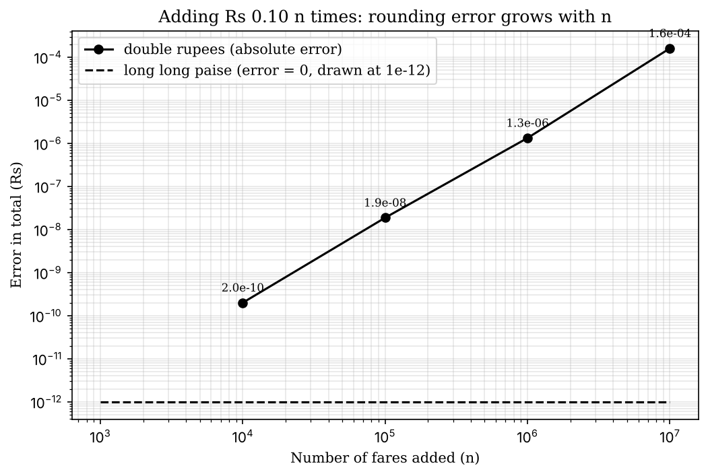

# Task 3 - Choose Data Types and Check Type Compatibility

**Name:** <your name>
**Register No:** <your register number>
**Course:** Object-Oriented Programming using C++ - Assignment 1 [CO1]

> Files in this folder:
> - `task03_analysis.md` - this analysis
> - `task03.cpp` - program that prints sizes, ranges, the mixed-type expression, the overflow check and the precision experiment
> - `task03_output.txt` and the output screenshot - result of running `task03.cpp`
> - `task03_error_growth.png` - chart of the rounding error of `double` against the number of fares

**Compile and run:**
```
g++ -std=c++17 -Wall -Wextra task03.cpp -o task03
./task03
```

---

## 1. Data type chosen for every value

| Value in the system | Type chosen | Why | sizeof (measured) |
|---|---|---|---|
| Fare, balance, recharge amount, totals | `long long` (in paise) | exact whole numbers; very large range | 8 bytes |
| Hour of the day (0 to 23) | `int` | small whole number | 4 bytes |
| Peak flag, weekend flag | `bool` | only two states | 1 byte |
| Zone number | `enum class Zone` (underlying `int`) | a fixed set of named values, safer than a plain number | 4 bytes (typical) |
| Percentages (surcharge, discount) | `int` | whole numbers | 4 bytes |
| Journeys per day | `long long` | up to 3,000,000 now and may grow | 8 bytes |
| Separator or single letter in output | `char` | one character | 1 byte |
| Number of table entries / array sizes | `unsigned` or `std::size_t` | never negative (see warning in Task 4) | 4 bytes |
| Temporary value whose type is obvious from the right side | `auto` | the compiler deduces the type, for example `auto r = b + i * d;` is a `double` | same as deduced type |
| `float` | **not used** | only about 7 digits of precision, too little for money | 4 bytes |

**Measured on my system** (`task03.cpp`):

```
bool        1 byte(s)
char        1 byte(s)
int         4 byte(s)
unsigned    4 byte(s)
long long   8 byte(s)
float       4 byte(s)
double      8 byte(s)
```

---

## 2. Ranges from `<climits>`

```
INT_MIN    -2147483648
INT_MAX    2147483647
UINT_MAX   4294967295
LLONG_MIN  -9223372036854775808
LLONG_MAX  9223372036854775807
```

---

## 3. Why money is stored in integer paise and not as `double` rupees

Computers store a `double` in binary. Many decimal fractions, such as 0.1 or 20.10, have no exact binary form, so the stored value is a very close approximation. Each addition can round again, so small errors build up. My program shows the effect directly:

```
0.1 + 0.2 == 0.3 ? false
0.1 + 0.2 = 0.30000000000000004
```

Money must be exact: a gate that is off by a paisa gives wrong fares and wrong totals, which is the "off by a paisa" fault in the scenario. Storing money as a whole number of paise (Rs 20.10 is the integer 2010) means every addition, subtraction and comparison is exact. Only the printing step divides by 100, to show rupees and paise.

---

## 4. Type compatibility rules

When `bool`, `int` and `double` appear in the same expression, the compiler applies the usual arithmetic conversions: smaller types are converted to the larger one.

`bool + int * double` is evaluated like this (from my program, `true + 3 * 2.5`):
1. `i * d` : the `int` 3 is converted to `double` 3.0, result 7.5 (`double`)
2. `b + 7.5` : the `bool` true is promoted to the `int` 1, then to `double` 1.0, result 8.5 (`double`)

**Output:** `true + 3 * 2.5 = 8.5  (result type: double)`

Going the other way (storing a `double` into an `int`) discards the fractional part silently, and mixing signed with unsigned values converts the signed one to unsigned. Both are covered in Task 4.

---

## 5. Is `int` enough for a day's collection across the network?

Assume 3,000,000 journeys a day at Rs 20.10 (2010 paise) each:

```
3,000,000 x 2010 paise = 6030000000 paise
INT_MAX                = 2147483647
Fits in int? NO - int overflows
Value a 32-bit variable would keep: 1735032704
```

The total, 6,030,000,000 paise, is almost three times `INT_MAX`, so `int` is **not enough**. The wrapped value 1,735,032,704 is completely wrong (in C++, overflow of a *signed* `int` is also undefined behaviour). A `long long` holds values up to about 9.2 x 10^18, so it is safe by a very large margin. This is why `long long` is chosen for all money and totals.

---

## 6. Evidence: precision problem and its resolution

**Problem:** add Rs 0.10 n times, once in `double` rupees and once in `long long` paise.

```cpp
double rs = 0.0;
long long paise = 0;
for (long long k = 0; k < n; ++k) { rs += 0.10; paise += 10; }
```

**Measured result:**

| n (fares added) | `double` total (Rs) | Exact total from paise (Rs) | Error (Rs) |
|---|---|---|---|
| 1,000 | 100.0000000000 | 100.0000000000 | about 0 |
| 10,000 | 1000.0000000002 | 1000.0000000000 | 0.0000000002 |
| 100,000 | 10000.0000000188 | 10000.0000000000 | 0.0000000188 |
| 1,000,000 | 100000.0000013329 | 100000.0000000000 | 0.0000013329 |
| 10,000,000 | 999999.9998389754 | 1000000.0000000000 | -0.0001610246 |



**Resolution:** store money as `long long` paise. The paise column is exact at every size, and its error is exactly zero.

---

## 7. Alternative Concept and Complexity Analysis: `double` rupees instead of `long long` paise

If money were stored as `double` rupees, a fare would be written like `20.10`, a balance like `100.00`, and the totals would be built by repeated floating-point addition:

```cpp
double balance = 100.00;
double fare = 20.10;
balance -= fare;                       // 79.9 (approximately)
if (balance - 10.0 >= 50.0) { ... }    // comparison on approximate values can fail
```

**Time per addition.** One addition instruction in both cases, so the time per addition is **O(1)** in both. Adding n fares takes O(n) in both. (My measurement of 10,000,000 additions, on my machine, was about 24,799 microseconds for `double` and 6,339 microseconds for `long long`. The absolute numbers depend on the computer and the compiler, so they are only evidence that both are fast and both grow linearly with n; do not rely on the ratio.)

**Space per value.** `double` is 8 bytes and `long long` is 8 bytes (measured above), so the space per value is **O(1)** and identical.

**How the rounding error grows when n fares are added.** Every `double` addition can introduce a rounding error of about half a unit in the last place, so in the worst case the error after n additions grows in proportion to n, written O(n x epsilon), where epsilon is the machine precision (about 2.2 x 10^-16 relative). The measurements agree with this: the error is zero at 1,000 fares and becomes visible and larger as n grows (2.0e-10 at 10,000, 1.9e-8 at 100,000, 1.3e-6 at 1,000,000 and 1.6e-4 at 10,000,000 in absolute terms). In this particular run it grew faster than in direct proportion, because the total itself also gets bigger, so each rounding step is larger. With `long long` paise the error is exactly zero for any n until the value exceeds about 9.2 x 10^18.

**Another risk of `double`.** Comparisons such as "is at least Rs 50 left?" can give the wrong answer when the true balance is exactly Rs 50 but the stored value is 49.99999999999999. With integer paise the comparison `balance - fare >= 5000` is always exact.

**Conclusion.** Time and space are the same, so the decision is made on correctness. `long long` paise gives exact results; `double` rupees gives approximate ones whose error grows with the number of transactions. `long long` paise is therefore the right choice for the metro.

---

## 8. Evidence summary

- Data-type table with `sizeof` for every value (sections 1 and 2)
- Why integer paise are used instead of `double` rupees (section 3)
- Type compatibility rules with a measured example (section 4)
- Overflow problem: `int` is not enough for the network total (section 5)
- Precision problem with a measured table, chart and its resolution (section 6)
- `double` alternative with time, space and error-growth analysis (section 7)
