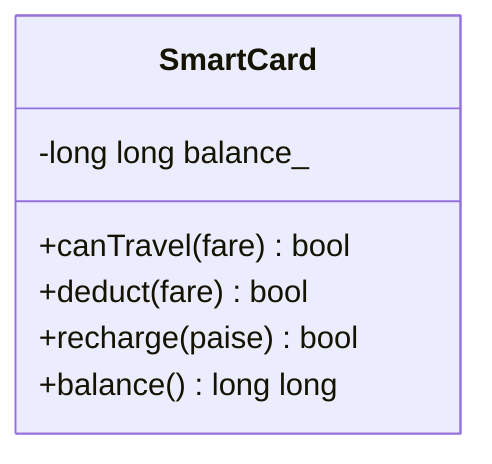

# Task 7 - From Procedural to Object-Oriented

**Name:** <your name>
**Register No:** <your register number>
**Course:** Object-Oriented Programming using C++ - Assignment 1 [CO1]

> Files in this folder:
> - `task07_analysis.md` - this analysis
> - `task07_procedural.cpp` and `task07_procedural_output.txt` - version 1, procedural style
> - `task07_oop.cpp` and `task07_oop_output.txt` - version 2, object-oriented style with `SmartCard`
> - `task07_public_demo.cpp` and `task07_public_output.txt` - alternative concept (public balance)
> - output screenshots of each program

**Compile and run (each file separately):**
```
g++ -std=c++17 -Wall -Wextra task07_procedural.cpp -o task07_procedural
./task07_procedural
g++ -std=c++17 -Wall -Wextra task07_oop.cpp -o task07_oop
./task07_oop
```

---

## 1. Version 1: procedural style (separate variable and free functions)

```cpp
long long balance = 10000;                 // global variable, Rs 100.00 in paise
constexpr long long MIN_BALANCE_PAISE = 5000;

bool canTravel(long long fare) { return balance - fare >= MIN_BALANCE_PAISE; }
void deduct(long long fare)    { balance -= fare; }      // no check inside
```

The balance is a global variable, so **any** line of the program can read or change it. `deduct()` trusts the caller to call `canTravel()` first.

**Output of `task07_procedural.cpp`:**

```
start                             balance = 10000 paise
after normal Rs 10 journey        balance = 9000 paise
after careless deduct(99999)      balance = -90999 paise
after direct write balance=-500   balance = -500 paise
```

The negative balance from the scenario appears here: a careless call to `deduct(99999)` and a direct write `balance = -500;` are both legal C++, and nothing stops them.

---

## 2. Version 2: object-oriented style (`SmartCard` with a private balance)

```cpp
class SmartCard {
    long long balance_;                              // PRIVATE
public:
    explicit SmartCard(long long paise) : balance_{paise} {}

    bool canTravel(long long fare) const {
        return fare >= 0 && balance_ - fare >= MIN_BALANCE_PAISE;
    }
    bool deduct(long long fare) {
        if (!canTravel(fare)) return false;          // the rule is checked here, in ONE place
        balance_ -= fare;
        return true;
    }
    bool recharge(long long paise) {
        if (paise <= 0) return false;                // negative recharge refused
        balance_ += paise;
        return true;
    }
    long long balance() const { return balance_; }   // read-only access
};
```



**Output of `task07_oop.cpp`:**

```
start                             balance = 10000 paise
deduct(1000)   -> true
after normal Rs 10 journey        balance = 9000 paise
deduct(99999)  -> false
after careless deduct(99999)      balance = 9000 paise
recharge(-500) -> false
after recharge(-500)              balance = 9000 paise
exact Rs 50 left: deduct(1000) -> true, balance 5000
4999 would remain: deduct(1000) -> false, balance 5999
```

The same careless call, `deduct(99999)`, is now **refused** and the balance stays 9000. A balance that would leave exactly Rs 50 (5000 paise) is allowed, and one that would leave 4999 is refused.

---

## 3. How the class prevents a negative balance

1. The balance `balance_` is **private**, so code outside the class cannot change it. I tested the line `card.balance_ = -500;` and the compiler rejects it:
   ```
   error: 'long long int SmartCard::balance_' is private within this context
   ```
2. The only functions that change `balance_` are `deduct()` and `recharge()`.
3. `deduct()` calls `canTravel()` first and returns `false` without changing anything if fewer than 5000 paise would remain, so the balance can never fall below Rs 50, and therefore never below zero.
4. `recharge()` refuses zero or negative amounts, and `canTravel()` refuses a negative fare, so the balance cannot be reduced through those paths either.

This is **encapsulation**: the data is protected, and the rule is attached to the data.

---

## 4. Which version is easier to change when the minimum balance changes?

Suppose the minimum balance changes from Rs 50 to Rs 75.

| | Procedural | Object-oriented |
|---|---|---|
| What must be edited | the constant, **and** every place in the program that changes `balance` must be checked to see that it respects the new limit | only the constant `MIN_BALANCE_PAISE` (or one line in `canTravel()`) |
| Risk of missing a place | high: any function can write `balance` | none: only `SmartCard` can change the balance |
| Number of places to review | all call sites, O(c) | one, O(1) |

The **object-oriented version is easier to change** because the rule is written once, next to the data it protects.

---

## 5. Comparison of the two designs

| Point | Procedural | Object-oriented |
|---|---|---|
| Where the balance lives | global variable | private member of `SmartCard` |
| Who can change it | any function | only `deduct()` and `recharge()` |
| Where the Rs 50 rule is checked | wherever the programmer remembers | once, inside `deduct()` |
| Can a negative balance occur? | yes (shown in the output above) | no (shown in the output above) |
| Several cards | needs arrays of separate variables | one object per card |
| Speed and memory | O(1) per journey, 8 bytes per card | O(1) per journey, 8 bytes per card |

---

## 6. Alternative Concept and Complexity Analysis: balance as a public data member

If the balance were kept in a public data member instead of a private member with `deduct()` and `canTravel()`, the solution would be:

```cpp
struct OpenCard {
    long long balance;                      // public: anyone can write it
    bool deduct(long long f) { if (balance - f < 5000) return false; balance -= f; return true; }
};
```

**Output of `task07_public_demo.cpp`:**

```
after normal journey: 9000
after c.balance = -500: -500
```

**Time and space.** Nothing changes. A journey is still one comparison and one subtraction, **O(1)**, and the card still needs one 8-byte value, **O(1)**. Private or public makes no difference to speed or memory.

**What is lost.** The class can no longer guarantee its own rules. Any part of the program can write `c.balance = -500;`, which breaks:
- **rule 1**: the balance must be at least Rs 50 after a journey (and never negative);
- **rule 4**: all values must be exact and valid, because code outside the class can store any value, including a negative recharge.

A bug would have to be searched for in the **whole program** instead of in one class, which is the exact situation described in the scenario ("a negative balance once appeared on a card").

**Conclusion.** The private member costs nothing in speed or memory and protects the main rule of the system, so the object-oriented version with a private balance is the right design.

---

## 7. Evidence summary

- Procedural program and output showing the negative balance (section 1)
- Object-oriented program and output showing the rule being enforced (section 2)
- Compiler error for access to the private balance (section 3)
- Reasoned comparison of how easily each version changes (sections 4 and 5)
- Public-member alternative with its output and Big-O analysis (section 6)
